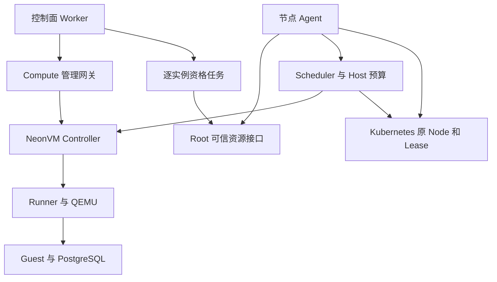

# 当前资源与调度架构

本分支的标准产品使用 Kubernetes 主 CNI、NeonVM 与 DSGA 安全协议。旧桥接、额外 VXLAN、旧 Agent/Scheduler 交互图不作为当前默认架构。

Helm 管理 Controller、Scheduler、Agent、设备插件及权限声明；站点入口创建当次身份并读取真实 capacity/allocatable；原生协议执行预算 CAS、资源预留、操作结清与退役。控制面负责公开 Operation，不能跨越资源所有者自行改写内存事实。

## 安全边界

每次业务操作绑定原 VM、Runner、Node、Lease 和资格来源。发现变化或读取未确认时停止相关准入，保留原意图；不能换 UID、跳过 WAL 或复用别的报告掩盖未知状态。

普通 Pod 与 init container 必须有可核验的硬限，调度预算包含已占用资源和声明的系统预留。缺少硬限时拒绝初始化，不能用 requests 或估算值补齐。只有可信 Host 名称可进入 Node 权限的 `resourceNames`；空列表不能扩大成全局授权。

自动伸缩的完成标准包括同一 Compute 的真实 Guest 物理内存往返、原 PostgreSQL 身份和数据保持、WAL 历史结清。VM spec 或 Pod limits 变化只是一部分观察。

## 网络与能力范围

当前标准配置关闭额外 VXLAN，保留 Controller 当前实现必需的 IPAM 附件。内部管理使用受信任的 TLS 与隔离凭据，SQL 客户端验证 CA 和服务身份；公网域名不是前置条件。

现有认证运行规格只覆盖已验收内核、Guest、PG17/PG18 与资源策略。迁移、任意 CPU/内存组合、其他网络和新 Node 连续登记不能从上游功能描述推导为本分支已通过。根目录旧位图和图源已清理，原图可从 Git 历史追溯。

上游详细协议参考保留在组件目录；[旧架构原文](https://github.com/william-lbn/autoscaling/blob/a5e925b5f9180e083e9c86dd7be4ee3f55b014cb/ARCHITECTURE.md)仅用于差异审查。当前产品分层与完整验收步骤以 [Helm 标准文档](https://github.com/william-lbn/neon-helm/tree/codex/dsga-neon-helm-v3-20261019/docs/standard)为准。
